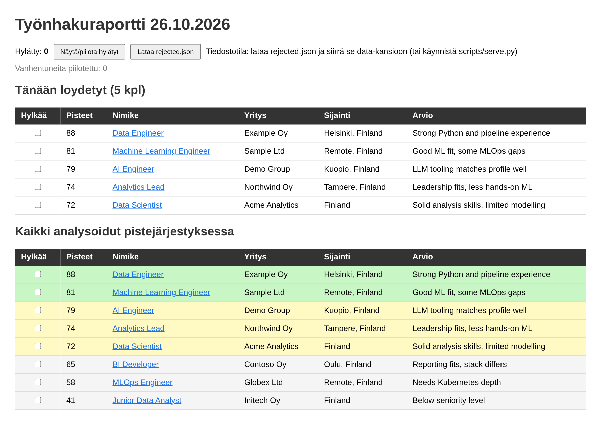
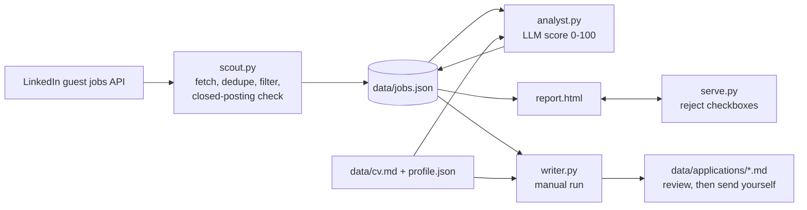

# job-search-bot

A small, dependency-free Python pipeline that finds job postings, scores them against your profile with an LLM, and drafts tailored applications for the good matches. Sending applications stays manual on purpose.



*Example report generated from the fictional data in `examples/jobs.example.json`.*

## How it works



| Step | Script | What it does |
|------|--------|--------------|
| 1. Scout | `scripts/scout.py` | Fetches postings for your keywords from LinkedIn's public guest jobs API, de-duplicates, filters by location, checks for closed postings, writes an HTML report |
| 2. Analyst | `scripts/analyst.py` | Scores each new posting 0-100 with a short rationale (OpenRouter, default model DeepSeek) |
| 3. Writer | `scripts/writer.py` | Drafts an application letter (FI or EN) for postings at or above `min_score`. Run manually so you can review before sending |
| UI | `scripts/serve.py` | Local server for the report: tick a checkbox to reject a posting, saved to `jobs.json` |

Scout calls the analyst automatically after fetching. Everything uses only the Python standard library (3.10+).

## Setup

```bash
git clone <this repo>
cd job-search-bot
mkdir data
cp examples/profile.example.json data/profile.json   # edit: skills, keywords, locations
cp examples/cv.example.md data/cv.md                  # replace with your own CV
cp .env.example .env                                   # add your OPENROUTER_API_KEY
```

All personal data lives in `data/` (git-ignored). Set `JOBBOT_DATA` to use another location.

## Usage

```bash
python scripts/scout.py     # fetch, score, build data/report.html
python scripts/serve.py     # open the report with saving of rejections
python scripts/writer.py    # draft applications into data/applications/
```

Run `scout.py` daily with cron (Linux/macOS) or Task Scheduler (Windows).

## Profile options (`data/profile.json`)

| Key | Meaning |
|-----|---------|
| `skills` | Free-text skill summary used in the scoring prompt |
| `keywords` | Search terms sent to LinkedIn |
| `search_location` | LinkedIn location filter, e.g. `Finland` |
| `locations` | Extra location substrings that count as relevant (remote and country-wide postings always pass) |
| `min_score` | Minimum score for the writer to draft an application |

## Design notes

- Posting text is passed to the model as untrusted data; the prompt tells it to ignore instructions inside descriptions.
- `serve.py` binds to 127.0.0.1 only and checks Host and Origin headers.
- Job data is written atomically (temp file, then replace).
- Scraping a public endpoint can break whenever LinkedIn changes its markup, and LinkedIn's terms may restrict automated access. Use at low volume and at your own risk.

## Lyhyesti (FI)

Työnhakubotti hakee ilmoitukset LinkedInin vieras-API:sta, pisteyttää ne CV:n ja taitojen perusteella kielimallilla ja luonnostelee hakemukset hyville osumille. Hakemusten lähettäminen on tarkoituksella manuaalista. Omat tiedot (CV, profiili, ilmoitukset, API-avain) pysyvät `data/`-kansiossa, joka ei mene gitiin.
